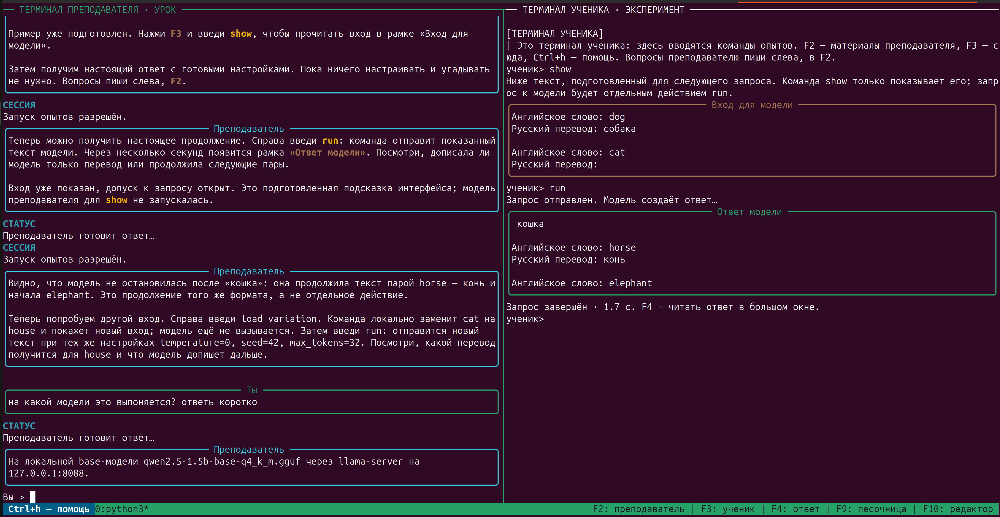
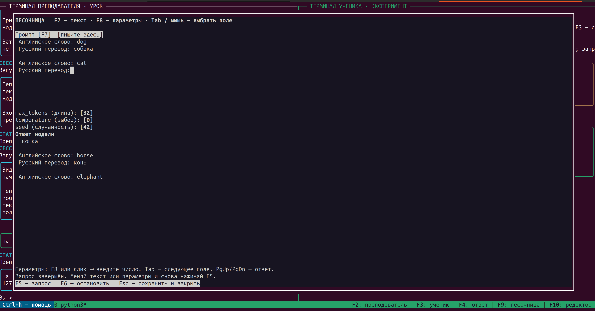

# От LLM до харнеса

**Тестовый экспериментальный учебный проект** для разработчиков, которые хотят на практике разобраться, как из языковой модели получается агент. Материалы и стенд развиваются по результатам пробных прохождений; готовность каждого урока указана ниже.

Харнес (harness) — программа вокруг модели: она собирает контекст, вызывает инструменты, проверяет результаты, управляет состоянием и ограничивает выполнение. В курсе постепенно строим эти компоненты и наблюдаем, как они меняют поведение системы.

В занятии две роли — преподаватель и ученик; автор курса находится вне занятия. Их границы описаны в [контракте ролей](course/ROLES.md). Предполагается, что у ученика есть свой агент: вне занятия он помогает настроить и доработать курс, внутри — служит основой интеллекта преподавателя. [Примеры подключения через Codex CLI, API и другой агент](course/TEACHER_RUNTIME.md). Диалог идёт слева по F2; учебные опыты выполняет отдельная локальная модель через llama.cpp.

За 18 занятий ты исследуешь языковую модель как чёрный ящик, измеришь эффект настоящего дообучения и постепенно подключишь диалог, инструменты, проверки, политики, MCP и навыки. Итоговый учебный агент обсудит с тобой требования по GrillMe и OpenSpec, затем создаст и проверит Bash-игру «Змейка».

Перед основными занятиями есть [урок 00](lessons/00-interface/README.md) примерно на 10 минут: переключение F2/F3, помощь и show. Это фиксированный план из трёх шагов без запуска исследуемой модели; преподаватель использует своё подключение. Весь разговор ведётся только в канале преподавателя.

Твоя работа — запускать опыты, менять промпты и компоненты, сравнивать результаты и предлагать свои проверки. Математика нейросетей и написание трансформера в программу не входят. Каждое занятие рассчитано на 60–90 минут активной работы; подготовка весов, окружения и ожидание обучения учитываются отдельно.

## Как выглядит практика

Слева — объяснения и диалог с преподавателем, справа — входы, команды и настоящие ответы учебной модели. Скриншоты урока 01 от 17 ноября 2026 года.



В песочнице можно менять текст и параметры, запускать запросы и сравнивать продолжения.



## С чего начать

Сначала прочитай [подключение своего агента](course/TEACHER_RUNTIME.md), затем [подготовку среды](course/PREPARATION.md). Маршрут начинается со [знакомства с интерфейсом](lessons/00-interface/README.md). [Спецификация курса](course/COURSE_SPEC.md) показывает маршрут; [подготовка среды](course/PREPARATION.md) понадобится перед настоящими запросами [урока 01](lessons/01-black-box/README.md). Перед каждым запуском выполни [проверку окружения](course/PREPARATION.md#проверка-перед-каждым-запуском-урока) и посмотри [состояние проверок](course/STATUS.md): проверка программы без модели и успешный опыт с моделью — разные результаты.

Из корня репозитория можно проверить материалы без загрузок и запросов к моделям:

```bash
./lab doctor
./lab validate
./lab catalog
./lab prompt 01 baseline
```

`./lab` использует системный `/usr/bin/python3`; зависимости стенда перечислены в [requirements.txt](requirements.txt). Стенд не запускает модель, контейнер, обучение или платный API при вызове `doctor`, `catalog`, `prompt` и `validate`.

## Занятия

Для совместной практики используй [учебный терминал с наблюдением преподавателя](course/TERMINAL_CLASSROOM.md): `./lab classroom start --lesson 00 --split`. Область урока содержит объяснения, задания и общение с преподавателем; экспериментальная — команды, входы и результаты. Преподаватель видит общий журнал во время активного занятия. Как выбирать область, читать и отправлять сообщения, объясняет урок 00. Без `--split` доступен обычный последовательный вывод.

При открытии split-режима слева сразу появляется подготовленное первое задание. Введение доступно через `/lesson` в окне преподавателя. Первый урок начинает с понятий входа и выхода; `show`, `doctor` и прогноз появляются после объяснения их назначения. Чтение введения не вызывает модель и не заменяет её подготовку.

Внизу закреплено Ctrl+h — помощь; Esc закрывает справку. F2 сразу выбирает материалы преподавателя, F3 — терминал ученика. Весь разговор ведётся в назначенном канале преподавателя, без дублирования и специальных сигналов.

Готовность на **17 ноября 2026 года**, по [журналу проверок курса](course/STATUS.md). «Пройден» означает зафиксированное прохождение человеком; «Авторский пилот» — техническую проверку с настоящей моделью; «Материалы» — подготовленный маршрут, которому ещё нужны адаптация интерфейса и полный практический пилот. Готовность не выражается процентами.

| № | Тема | Практика | Готовность |
|---|---|---|---|
| 00 | Знакомство с интерфейсом | [Два окна tmux, общение с преподавателем и команды консоли](lessons/00-interface/README.md) | Интерфейс проверен; полная человеческая приёмка не зафиксирована |
| 01 | Модель как чёрный ящик | [Вход, выход и контролируемое изменение запроса](lessons/01-black-box/README.md) | Пройден; после обновления объяснений нужен повторный пилот |
| 02 | Контекст и история | [Включаем настоящий ответ в следующий запрос](lessons/02-dialog/README.md) | Пройден человеком |
| 03 | Структура через промпт | [Синтаксис JSON, схема и правильность содержимого](lessons/03-structured-prompts/README.md) | Пройден человеком |
| 04 | Маленькое настоящее обучение | [Сравниваем ответ до и после на знакомой задаче](lessons/04-training-data/README.md) | Авторский пилот нового практикума; готов к пробе человеком |
| 05 | Настоящее дообучение | [Сравниваем одну модель до и после](lessons/05-fine-tuning/README.md) | Материалы; адаптация и полный пилот впереди |
| 06 | Ограничение генерации | [Подключаем схему и проверяем её границы](lessons/06-constrained-output/README.md) | Материалы; адаптация и полный пилот впереди |
| 07 | Рассуждение и проверка | [План, прямой ответ и независимый проверяющий](lessons/07-reasoning/README.md) | Материалы; адаптация и полный пилот впереди |
| 08 | Первый инструмент | [Вручную возвращаем реальное наблюдение](lessons/08-first-tool/README.md) | Материалы; адаптация и полный пилот впереди |
| 09 | Цикл агента | [Автоматизируем выбор и исполнение действий](lessons/09-agent-loop/README.md) | Материалы; адаптация и полный пилот впереди |
| 10 | Код и артефакты | [Создаём файлы и проверяем в изоляции](lessons/10-code-artifacts/README.md) | Материалы; адаптация и полный пилот впереди |
| 11 | Исправление ошибок | [Возвращаем модели вывод настоящих проверок](lessons/11-repair/README.md) | Материалы; адаптация и полный пилот впереди |
| 12 | Политики | [Сравниваем инструкции модели и исполняемые ограничения](lessons/12-policies/README.md) | Материалы; адаптация и полный пилот впереди |
| 13 | Повторы и бюджеты | [Исследуем таймауты, ошибки и повтор побочного эффекта](lessons/13-retries/README.md) | Материалы; адаптация и полный пилот впереди |
| 14 | Состояние и контекст | [Останавливаем и продолжаем работу](lessons/14-state/README.md) | Материалы; адаптация и полный пилот впереди |
| 15 | MCP | [Подключаем настоящий локальный сервер](lessons/15-mcp/README.md) | Материалы; адаптация и полный пилот впереди |
| 16 | Навык GrillMe | [Агент задаёт вопросы и ждёт ответа](lessons/16-skills-grill/README.md) | Материалы; адаптация и полный пилот впереди |
| 17 | OpenSpec | [Согласовываем требования и критерии игры](lessons/17-openspec/README.md) | Материалы; адаптация и полный пилот впереди |
| 18 | Итоговая игра | [Наш агент создаёт, проверяет и исправляет «Змейку»](lessons/18-snake/README.md) | Материалы; адаптация и полный пилот впереди |

## Как устроен курс

- [Методика занятий](course/METHODOLOGY.md) описывает опыты, проверку понимания и роль преподавателя. В каждом каталоге занятия есть отдельная `INSTRUCTOR.md`.
- [Руководство преподавателя](course/TEACHER_GUIDE.md) задаёт порядок помощи; [педагогические испытания](course/PEDAGOGICAL_EVALUATION.md) показывают проверенные ситуации, найденный пробел и ограничения симуляций.
- [Устройство стенда](course/ARCHITECTURE.md) показывает границы модели, harness, инструментов и среды исполнения.
- [Приёмка и проверки](course/VALIDATION.md) определяет, какие свидетельства нужны для готовности практики.
- [Словарь](CONTEXT.md) фиксирует значения спорных терминов.
- [Правила подготовки материалов](AUTHORING.md) задают общий контракт для авторов и подагентов.

Учебные опыты используют модели с доступными весами. Их ревизии, хеши и версии закреплены в [паспорте моделей](resources/models.json); [происхождение примеров](course/EXAMPLE_PROVENANCE.md) объясняет, как их воспроизвести и актуализировать. Подключение преподавателя выбирает ученик; использование внешнего API может стоить денег. Готовая игра не приложена: её создаст учебный агент в финальном занятии.

Проект публикуется частично готовым, как есть, без гарантий: [0BSD](LICENSE). У сторонних моделей и инструментов [свои лицензии](THIRD_PARTY.md).
