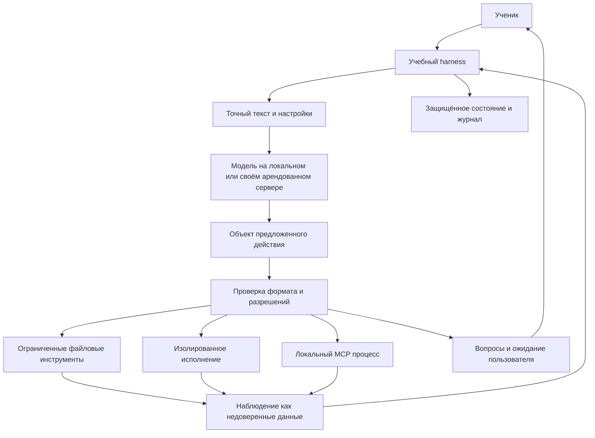

# Устройство учебного стенда

Стенд разделяет ядро модели, управляющую программу и среду исполнения. Ученик может посмотреть полный текст запроса, предложение действия, решение политики, фактический результат инструмента и условие завершения.

## Файлы программы

| Компонент | Где читать | За что отвечает |
|---|---|---|
| Команды | `coursekit/__main__.py` | Явно связывает команды и компоненты. |
| Ядро | `coursekit/model.py` | Один POST `/completion`, вход и результат. |
| Граница HTTP | `coursekit/model_http_worker.py` | Один ограниченный по времени процесс для запроса. |
| Цикл агента | `coursekit/agent.py` | Предложение, проверка, действие, наблюдение, следующий шаг. |
| Политики | `coursekit/policy.py` | Разрешённые инструменты, пути и размер данных. |
| Изоляция | `coursekit/sandbox.py` | Запуск сгенерированного кода только в контейнере. |
| MCP | `coursekit/mcp.py`, `coursekit/mcp_server.py` | Реальный протокол между двумя процессами. |
| Журнал | `coursekit/trace.py` | Наблюдаемые события с UTC временем. |
| Навык | `skills/grill-me.md` | Подключаемая учебная инструкция интервью. |

Стек не оборачивает существующий Codex. Навык GrillMe здесь — явно обозначенная адаптация инструкции, которую читает наш harness и получает наше ядро. OpenSpec запускается как настоящий подготовленный CLI в среде, где доступна соответствующая версия.

## Учебная сессия и преподаватель

Урок 00 использует два терминальных представления одной Session: материалы и команды опытов. Эти представления не являются исполнителем роли преподавателя. Для учебного диалога необходимо отдельно подключить преподавателя и его канал; текущая реализация такого подключения не содержит. Авторская работа в чате разработки находится вне занятия. Подробности — в [контракте ролей](ROLES.md).

Переход между областями и прокрутка — обычные действия tmux. Личные конфигурации не читаются: сервер получает `-f /dev/null` и собственный socket в `/tmp`. Выход из комбинированного окна закрывает допуск, запрашивает остановку активного опыта, проверяет её и завершает только свой сервер. Неподтверждённая уборка сохраняет необходимость сверки вместо объявления успеха.

[Режим совместного терминала](TERMINAL_CLASSROOM.md) добавляет наблюдение за явно запущенными опытами. `coursekit/classroom_console.py` принимает известные команды ученика, а `coursekit/classroom.py` хранит допуск запусков, разрешённые компоненты, журнал и указатель на активный опыт. Фиксированный `classroom_worker.py` выполняет выбранную операцию через уже существующие интерфейсы ядра, агента, MCP и контейнера.

Перед запуском фиксируются вход, параметры и разрешения. Рабочий процесс передаёт события преподавателю во время вычисления. Изменение промпта и настроек относится к следующему опыту. Журнал занятия находится вне рабочей папки агента. Произвольные команды host shell и скрытая запись других терминалов отсутствуют.

Преподаватель читает состояние и новые события, отправляет советы и управляет допуском. Пауза блокирует следующий запуск; стоп адресован конкретному опыту и требует подтверждения завершения. При невозможности подтвердить уборку остаётся явный неопределённый исход. Совет не превращается в команду или часть модельного входа без участия ученика.

При одном пользователе ОС это педагогический режим управления сессией. Он не разграничивает права двух разных Unix пользователей и не даёт ассистенту непрерывное фоновое наблюдение после завершения его активного хода.

## Предложение и исполнение

Модель выдаёт один JSON объект с `action` и `arguments`. Поддерживаются чтение и запись файлов, запуск Bash, вызов MCP, вопрос пользователю и завершение. Сам текст `run_bash` ничего не исполняет. Форму и разрешения проверяет доверенная программа. По умолчанию разрешены только чтение и запись файлов, вопрос и завершение; shell подключается явно.

`ask_user` переводит ход в `waiting_for_user`. Весь раунд вопросов сохраняется, а `--resume` и `--answer-file` возвращают ответ ученика в историю. Только `finish` означает успешное завершение. Неуспех теста, исчерпание бюджета и неизвестный исход действия не превращаются в успех.

## Границы исполнения

Файловые операции проверяют принадлежность рабочему каталогу, тип файла, символические и жёсткие ссылки, количество и суммарный объём данных. Каталог программы, состояние, журналы и исходные навыки не должны попадать в область, где агент может менять файлы.

Для Bash входная рабочая папка доступна контейнеру только для чтения. Работа происходит в ограниченной временной файловой системе. После исполнения программа останавливает процессы контейнера, проверяет ограниченный снимок обычных файлов и переносит разрешённые изменения. Прямая запись контейнера в каталог хоста не используется. Удаление ранее существовавшего файла может быть отклонено как неподдерживаемое действие; это ограничение учебного профиля нужно учитывать в опытах.

У контейнера отключена сеть, корень доступен только для чтения, ограничены память, CPU, число процессов, время и вывод. Домашние каталоги и управляющий socket Docker не передаются. При таймауте завершается сам контейнер. Отсутствие подготовленного образа или daemon приводит к отказу, а не к запуску кода на хосте. Фактическую изоляцию нужно проверять на подготовленной машине отдельно от тестов с заглушкой Docker.

Инструкции «сначала выясни требования» и «не пиши код до согласования» влияют на поведение модели. Они не становятся файловой политикой только от включения в промпт. Ученик проверяет эту разницу в занятиях 12 и 17.

## Состояние и повторы

Идентификатор действия связывает предложение, разрешение, начало исполнения и результат. Перед действием с побочным эффектом сохраняется `pending`. Если программа прервана и исход неизвестен, продолжение требует разобраться с фактическим артефактом; автоматического повторения нет. Счётчики использованных шагов и запросов сохраняются.

Повторы транспортного запроса, исправление JSON и исправление программы — разные переходы. В основной HTTP клиент встроенного автоматического повтора нет. Временные ошибки и идемпотентность исследуются отдельно в занятии 13. Endpoint и настройки можно связать с сохранённым запуском; неизменность весов за тем же endpoint подтверждается отдельно по карточке запуска и контрольной сумме подготовленных весов.
